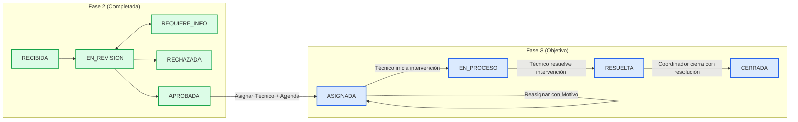

# Plan de implementación — ServiGest P0

**Fecha:** 2026-11-17  
**Estado:** Fases 0, 1 y 2 completadas; Fase 3 (técnico, cliente y dashboard) en curso.  
**Fuentes de verdad:** Este documento y `docs/fase-3-plan.md` son las fuentes de verdad. `docs/acuerdo-diseno.md` aporta únicamente contexto histórico.  

---

## 0. Decisiones y Estado Real del Repositorio

| Tema | Decisión y Estado Actual |
|---|---|
| Repositorio remoto | Repo público `servigest` en la cuenta `wblade-jg` |
| Fase 0 — Landing | ✅ Cerrada y mergeada a `main` (`1194577`). Responsive simple sin JS adicional. |
| Fase 1 — API Pública | ✅ Implementada. Formulario público con adjuntos (magic bytes), seguimiento por token y SSE. |
| Fase 2 — Auth & Sesión | ✅ Sesión en PostgreSQL (`sesiones`), cookie httpOnly `SameSite=Lax`, CSRF obligatorio con `X-CSRF-Token`, bloqueo tras 5 intentos fallidos. |
| Fase 2 — REST Estricto | ✅ Recursos en sustantivos. Todas las transiciones del ciclo de vida se ejecutan mediante `PATCH /api/solicitudes/:id/estado` con `{ estado, ...datos }`. La regeneración de token público se expone como subrecurso `POST /api/solicitudes/:id/token`. Sin verbos en la URL. |
| Fase 2 — FSM Declarativa | ✅ Motor de transiciones unificado en `api/src/modules/solicitudes/service.js` basado en tabla declarativa con validación de roles, guards contextuales, auditoría atómica en `eventos_solicitud` y notificaciones SSE estrictamente post-commit. |
| Fase 2 — Ciclo de Revisión | ✅ `REQUIERE_INFORMACION → EN_REVISION` exige nota interna documentando la gestión realizada. Se eliminó la aprobación directa desde `REQUIERE_INFORMACION`, requiriendo volver primero a `EN_REVISION`. |
| Fase 2 — Creación Interna | ✅ Solicitudes creadas por Coordinador/Admin mediante `POST /api/solicitudes` se guardan con origen `PUBLICO` y `organizacion_nombre`. Las creadas por Cliente usan origen `CLIENTE` con su `organizacion_id`. |
| Fase 2 — Frontend | ✅ Vistas de `Bandeja.tsx` y `Detalle.tsx` con modales interactivos para capturar datos requeridos según la transición. UI migrada de Tailwind CSS a Material UI 9 con tema propio (ver §4.3). |
| Fase 2 — Demo Seed | ✅ `seeds/003_usuarios_demo.sql` con Admin, Coordinador y 2 Clientes (contraseña: `Demo1234!`). |
| Backend — Módulos | ✅ API migrada a ESM nativo (`"type": "module"`): imports con extensión `.js`, sin `require`/`module.exports`, `__dirname` reemplazado por `import.meta.url` y Jest en modo ESM (`--experimental-vm-modules`). |

---

## 1. Fases del Proyecto

| Fase | Rama | Estado | Entregable |
|---|---|---|---|
| 0 | `feature/landing-page` | ✅ Mergeada | Landing cerrada: fix visual, header responsive, build/lint, commit |
| 1 | `feature/api-public-flow` | ✅ Implementada | Backend base + formulario público + seguimiento por token |
| 2 | `feature/auth-coordinator` | ✅ Completada | Login, sesiones, RBAC, REST estricto, FSM unificada, bandeja y triaje del coordinador |
| 3 | `feature/technician-client` | 🔄 En progreso | Asignación (agenda, franjas, SLA), intervenciones del técnico, portal del cliente, adjuntos y dashboard |
| 4 | `feature/qa-demo` | ⏳ Pendiente | Suite completa (12 grupos de pruebas), seed definitivo con 15 casos, README y guion de demo |

---

## 2. Fase 0 — Cierre de la Landing (Completada)

1. `web/src/app/pages/Inicio.tsx`: corrección visual de tokens de color (`bg-lavanda-honda`).
2. `web/src/components/SiteHeader.tsx`: cabecera responsive simple sin JavaScript adicional.
3. Verificación de build y lint en frontend (`npm run lint` y `npm run build`).

---

## 3. Fase 1 — Flujo Público y Base del Backend (Completada)

- Estructura base de `api/`: configuración con dotenv, pool de `pg`, Swagger en `/api/docs`.
- Base de datos: migración inicial `001_esquema.sql` (esquema completo) y `002_seed_catalogos.sql` (especialidades, categorías, reglas SLA).
- Endpoints públicos:
  - `GET /api/public/categorias`: categorías activas con especialidad requerida.
  - `POST /api/public/solicitudes`: multipart con validación de magic bytes para adjuntos, persistencia fuera del web root en `uploads/`, código secuencial `SOL-YYYY-XXXXX`, token de 32 bytes y rate limit de 5/hora por IP.
  - `GET /api/public/seguimiento/:token`: vista pública aislada (sin notas, contacto ni resolución).
  - `GET /api/public/seguimiento/:token/eventos`: canal SSE de seguimiento público.
- Frontend público: `/solicitar`, `/seguimiento/:token`, `/servicios`, `/planes`, `/contacto`.

---

## 4. Fase 2 — Autenticación, RBAC y Coordinación (Completada)

### 4.1. Módulo `auth` y Middlewares
- Rutas: `POST /api/auth/login`, `POST /api/auth/logout`, `GET /api/auth/me`, `PATCH /api/auth/password`.
- Seguridad: hash SHA-256 de tokens de sesión en BD, cookie httpOnly `SameSite=Lax`, CSRF obligatorio en mutaciones (`X-CSRF-Token`), bloqueo de 15 min tras 5 intentos fallidos de login.
- Middlewares: `autenticar` (valida sesión activa), `exigirCsrf` (valida token CSRF), `soloRoles(...roles)` (control de acceso por rol).

### 4.2. Módulo `solicitudes` (REST Estricto y FSM Declarativa)
- **Endpoints unificados:**
  | Método | Ruta | Roles | Descripción |
  |---|---|---|---|
  | GET | `/api/solicitudes` | ADMIN, COORDINADOR, TECNICO, CLIENTE | Listado paginado con filtros. Cliente filtra automáticamente por `organizacion_id`; Técnico por `tecnico_id`. |
  | POST | `/api/solicitudes` | ADMIN, COORDINADOR, CLIENTE | Creación interna. Si es interno: origen `PUBLICO` + `organizacion_nombre`. Si es Cliente: origen `CLIENTE` + `organizacion_id`. |
  | GET | `/api/solicitudes/:id` | ADMIN, COORDINADOR, TECNICO, CLIENTE | Detalle. Cliente y Técnico ajenos reciben `404`. Cliente no recibe notas ni eventos de auditoría. |
  | PATCH | `/api/solicitudes/:id/estado` | ADMIN, COORDINADOR, CLIENTE | Transición de estado (`{ estado, ...datos }`). |
  | POST | `/api/solicitudes/:id/token` | ADMIN | Regeneración de token público (subrecurso administrativo). |
  | GET | `/api/solicitudes/:id/eventos` | ADMIN, COORDINADOR | Historial de auditoría append-only. |
  | GET | `/api/solicitudes/:id/notas` | ADMIN, COORDINADOR, TECNICO | Listado de notas internas (técnico solo si está asignado). |
  | POST | `/api/solicitudes/:id/notas` | ADMIN, COORDINADOR, TECNICO | Creación de nota interna (`INTERNA` o `SOLICITUD_INFORMACION`). |

- **Motor de Transiciones:**
  - `TRANSICIONES`: tabla de configuración declarativa con `roles`, `tipoEvento`, `validar()` y `aplicar()`.
  - Transacciones atómicas con bloqueo pesimista `SELECT ... FOR UPDATE OF s`.
  - `eventos_solicitud` append-only insertado en la misma transacción.
  - Emisión de SSE `solicitud.estado` estrictamente **post-commit** (fuera de `conTransaccion`).
  - Transiciones de Fase 2 operativas:
    - `RECIBIDA → EN_REVISION` (Coordinador, Admin).
    - `EN_REVISION → REQUIERE_INFORMACION` (Coordinador, Admin; nota obligatoria).
    - `REQUIERE_INFORMACION → EN_REVISION` (Coordinador, Admin; nota obligatoria de gestión).
    - `EN_REVISION → APROBADA` (Coordinador, Admin; prioridad obligatoria, SLA congelado y constancia si es público).
    - `EN_REVISION / REQUIERE_INFORMACION → RECHAZADA` (Coordinador, Admin; motivo obligatorio).
    - `Cualquiera no terminal → CANCELADA` (Cliente antes de APROBADA; Coordinador/Admin en cualquier no terminal; motivo obligatorio).

### 4.3. Frontend y Verificación
- UI implementada en `web/src/app/pages/solicitudes/` (`Bandeja.tsx`, `Detalle.tsx`) con modales contextuales por acción.
- Pruebas automatizadas en `api/tests/`: 65 pruebas superadas (100% éxito en suites `auth`, `solicitudes`, `public`, `sse`).
- Build de producción frontend (`web`): `tsc -b && vite build` sin errores.

#### Migración a Material UI (decisión de stack)

- **Decisión:** la UI usa **Material UI 9** con **Emotion** y un **tema propio** (`web/src/theme.ts`). Se retiraron Tailwind CSS y su plugin de Vite. No se instala MUI X: las entradas nativas de fecha/hora se conservan.
- **Identidad visual:** dirección «expediente técnico» — fondo lavanda, superficies papel, reglas de 1 px en lugar de sombras, tipografía Archivo para interfaz y Source Serif 4 para texto largo, y un único acento violeta para acción y selección.
- **Tipografías:** autoalojadas con Fontsource (`@fontsource-variable/archivo`, `@fontsource-variable/source-serif-4`); se eliminó la carga desde Google Fonts en `index.html`.
- **Componente firma:** `RielEstado` representa el avance de la solicitud sobre la máquina de estados y sustituye la línea de tiempo improvisada.
- **Primitivos:** `web/src/components/ui/primitivos.tsx` envuelve MUI (`Boton`, `Campo`, `Entrada`, `AreaTexto`, `Selector`, `Modal`, `Tarjeta`, `BadgeEstado`, `EstadoVacio`, etc.) y concentra la identidad visual.
- **Accesibilidad:** los modales usan `Dialog` de MUI (foco atrapado, cierre con Escape y bloqueo de scroll); se desactiva el ripple y se mantienen etiquetas en minúscula/mixta, sin mayúsculas forzadas.
- **Validación:** `npm run lint` y `npm run build` en `web/`; no hay pruebas automatizadas de frontend, la demo se valida con el seed.

---

## 5. Fase 3 — Técnico, Cliente, Intervenciones y Dashboard (Plan Detallado)

**Rama:** `feature/technician-client`  
**Objetivo:** Completar el ciclo de vida operativo de la solicitud (`APROBADA → ASIGNADA → EN_PROCESO → RESUELTA → CERRADA`), habilitar las intervenciones técnicas con evidencias, crear el portal del cliente, implementar los CRUDs de administración de catálogos y desplegar el dashboard operativo con métricas de SLA.



---

### 5.1. Backend — Módulo de Asignación y Reasignación

Se integra en el motor de transiciones de `api/src/modules/solicitudes/service.js` vía `PATCH /api/solicitudes/:id/estado`:

#### Transiciones:
- `APROBADA → ASIGNADA`
- `ASIGNADA → ASIGNADA` (Reasignación)

#### Payload esperado:
```json
{
  "estado": "ASIGNADA",
  "tecnicoId": "uuid-del-tecnico",
  "fechaProgramada": "2026-11-20T14:00:00.000Z",
  "motivo": "Texto obligatorio solo en reasignación"
}
```

#### Motor de Validación de Asignación (Secuencia Estricta de 6 Pasos):
1. **Estado válido:** Solicitud en `APROBADA` o `ASIGNADA` (bloqueada con `FOR UPDATE`).
2. **Técnico activo:** Existe en `tecnicos` y `usuarios`, con rol `TECNICO` y `activo = true` en ambas tablas.
3. **Especialidad requerida:** Si la categoría de la solicitud tiene `especialidad_requerida_id IS NOT NULL`, verificar que el técnico posea esa especialidad en `tecnico_especialidad`. Si no la tiene: error `422 ESPECIALIDAD_NO_COINCIDE`.
4. **Franja horaria activa:** Convertir `fechaProgramada` a hora local de `America/Guayaquil`:
   - Extraer `dia_semana` (1=lunes ... 7=domingo) y hora del día.
   - Debe coincidir con un registro activo en `disponibilidad` (`hora_inicio <= hora < hora_fin`). Si no: error `422 FUERA_DE_DISPONIBILIDAD`.
5. **Sin solapamiento (Choque de agenda):** Verificar que el técnico no tenga otra solicitud en estado `ASIGNADA` o `EN_PROCESO` cuya `fecha_hora_programada` esté dentro de un rango de ±1 hora respecto a la nueva fecha. Si choca: error `422 CHOQUE_HORARIO`.
6. **Cumplimiento de SLA:** 
   $$\text{fechaProgramada} \le \text{fecha\_objetivo}$$
   Si se programa posterior al objetivo de SLA: error `422 FECHA_SUPERA_SLA`.
7. **Reasignación:** Si el estado actual es `ASIGNADA`, el campo `motivo` es obligatorio ($\ge 5$ caracteres). Tipo de evento de auditoría: `REASIGNACION` (en asignación inicial es `ASIGNACION`). Si la intervención ya comenzó (`EN_PROCESO`), la reasignación está prohibida.

---

### 5.2. Backend — Módulo de Intervenciones (`api/src/modules/intervenciones`)

Se crea el módulo `intervenciones` con arquitectura modular (`routes.js`, `controller.js`, `service.js`, `repository.js`).

#### Endpoints:
| Método | Ruta | Roles | Descripción |
|---|---|---|---|
| GET | `/api/solicitudes/:id/intervenciones` | ADMIN, COORDINADOR, TECNICO, CLIENTE | Lista intervenciones de la solicitud (Cliente ve diagnóstico/resultado; no ve notas internas). |
| POST | `/api/solicitudes/:id/intervenciones` | TECNICO | Inicia intervención. Transiciona la solicitud a `EN_PROCESO`. |
| PATCH | `/api/intervenciones/:id` | TECNICO | Resuelve intervención (cierre). Transiciona la solicitud a `RESUELTA`. |

#### Reglas de Negocio de Intervenciones:
- **Iniciar Intervención (`ASIGNADA → EN_PROCESO`):**
  - Solo el técnico asignado (`solicitud.tecnico_id === usuario.id`).
  - Inserta en `intervenciones` con `inicio = now()` (o fecha manual válida), `fin = NULL`.
  - La base de datos garantiza **una sola intervención abierta por solicitud** mediante índice único parcial:
    ```sql
    CREATE UNIQUE INDEX intervenciones_una_abierta_idx ON intervenciones (solicitud_id) WHERE fin IS NULL;
    ```
  - Actualiza la solicitud a `estado = 'EN_PROCESO'`.
  - Audita evento `INTERVENCION_INICIO`.
- **Resolver Intervención (`EN_PROCESO → RESUELTA`):**
  - Solo el técnico de la intervención activa.
  - Payload obligatorio:
    ```json
    {
      "fin": "2026-11-20T16:30:00.000Z",
      "diagnostico": "Falla en fuente de poder por fluctuación eléctrica.",
      "actividades": "Reemplazo de fuente de 650W y prueba de estrés.",
      "resultado": "Equipo operativo y entregado conforme al usuario.",
      "observaciones": "Se recomienda instalar regulador de voltaje."
    }
    ```
  - Validación: `fin > inicio`. Diagnóstico, actividades y resultado no vacíos.
  - Actualiza la intervención registrando `fin`, diagnóstico, actividades y resultado.
  - Actualiza la solicitud a `estado = 'RESUELTA'`, `resuelta_en = fin`, y copia `resultado` en `solicitudes.resolucion`.
  - Audita evento `INTERVENCION_FIN` y `CAMBIO_ESTADO`.

#### Transición a Cierre (`RESUELTA → CERRADA`):
- Se ejecuta vía `PATCH /api/solicitudes/:id/estado` con `{ estado: 'CERRADA' }`.
- Roles: `ADMIN`, `COORDINADOR`.
- Validación: La solicitud debe tener `resolucion IS NOT NULL`.
- Actualiza: `cerrada_por = usuario.id`, `cerrada_en = now()`.
- Audita evento `CIERRE`. Estado terminal (sin reapertura).

---

### 5.3. Backend — Módulo de Adjuntos Autenticados (`api/src/modules/adjuntos`)

Arquitectura de subida segura y almacenamiento privado fuera del web root (`uploads/`).

#### Endpoints:
| Método | Ruta | Roles | Descripción |
|---|---|---|---|
| POST | `/api/solicitudes/:id/adjuntos` | ADMIN, COORDINADOR, TECNICO, CLIENTE | Sube adjunto a una solicitud. |
| POST | `/api/intervenciones/:id/adjuntos` | TECNICO | Sube evidencia fotográfica o técnica a una intervención. |
| GET | `/api/adjuntos/:id/descargar` | Según visibilidad | Descarga de archivo protegida con streaming y cabeceras seguras. |

#### Reglas de Adjuntos:
- Límite de 5 adjuntos por solicitud y 5 por intervención.
- Límite de 5 MB por archivo.
- Tipos permitidos: `image/jpeg`, `image/png`, `application/pdf`. Validación estricta por *magic bytes* (sin confiar en la extensión enviada por el cliente).
- Guardado en disco con nombre UUID sin extensión ejecutable.
- **Autorización de descarga:** Un usuario con rol `CLIENTE` solo puede descargar adjuntos de solicitudes de su organización. Si intenta descargar un adjunto ajeno: responder **`404`**.

---

### 5.4. Backend — Administración de Catálogos y Entidades

Endpoints de administración protegidos para `ADMIN` (y consulta para `COORDINADOR`).

#### Módulos:
1. **`organizaciones` (`/api/organizaciones`):** CRUD de clientes corporativos (RUC único, razón social, dirección, teléfono).
2. **`usuarios` (`/api/usuarios`):** Creación y edición de usuarios internos y clientes. Validación de email único (`citext`) y hash bcrypt.
3. **`tecnicos` (`/api/tecnicos`):**
   - Habilitar técnico vinculado a usuario con rol `TECNICO`.
   - Asignación de especialidades (`PUT /api/tecnicos/:id/especialidades` reemplaza el conjunto completo).
   - Gestión de franjas de disponibilidad semanal (`/api/tecnicos/:id/disponibilidad`), validando que `hora_inicio < hora_fin` y sin solapamiento en el mismo día.
4. **`especialidades` y `categorias_servicio` (`/api/catalogos/...`):**
   - Configuración de categorías y su especialidad requerida.
5. **Regla general de eliminación:** Catálogos y usuarios se desactivan lógicamente (`activo = false`); no se permite `DELETE` físico si tienen relaciones en base de datos.

---

### 5.5. Backend — Dashboard Operativo (`api/src/modules/dashboard`)

Endpoint de métricas operativas calculadas en tiempo real directamente desde PostgreSQL (sin base de datos analítica externa).

#### Ruta:
- `GET /api/dashboard`:
  - Si el rol es `ADMIN` o `COORDINADOR`: métricas globales de toda la operación.
  - Si el rol es `CLIENTE`: métricas estrictamente filtradas por `solicitudes.organizacion_id = usuario.organizacionId`.

#### Métricas Calculadas:
1. **Distribución por estado:** Conteo agrupado de solicitudes activas y cerradas.
2. **Cumplimiento de SLA:**
   - Solicitudes a tiempo (`fecha_objetivo >= now()`).
   - Próximas a vencer (no terminales con `fecha_objetivo` dentro de las próximas 24 horas).
   - Vencidas (no terminales con `fecha_objetivo < now()`).
3. **Carga operativa por técnico:** Conteo de solicitudes en `ASIGNADA` y `EN_PROCESO` asignadas a cada técnico activo.
4. **Tiempo medio de resolución (MTTR):** Promedio de horas transcurridas entre `aprobada_en` y `resuelta_en` en el último mes.

---

### 5.6. Backend — Canal SSE de Técnicos

- `GET /api/eventos/tecnico`:
  - Autenticado, rol `TECNICO`.
  - Filtra y emite eventos en tiempo real destinados al técnico en sesión:
    - `solicitud.asignada`
    - `solicitud.reasignada`
  - Heartbeat cada 25 segundos.

---

### 5.7. Frontend — Vistas y Componentes de la Fase 3

Se incorporan las pantallas del portal según el rol autenticado:

```
web/src/app/pages/
├── solicitudes/
│   ├── Bandeja.tsx            # Actualizar con pestañas por rol
│   └── Detalle.tsx            # Modales de asignación, intervención, cierre y adjuntos
├── tecnico/
│   └── MiAgenda.tsx           # Vista del técnico con solicitudes asignadas y botón "Iniciar"
├── cliente/
│   └── SolicitarCliente.tsx   # Formulario corporativo simplificado
├── admin/
│   ├── Usuarios.tsx           # CRUD de usuarios y roles
│   ├── Organizaciones.tsx     # CRUD de clientes corporativos
│   ├── Tecnicos.tsx           # Gestión de técnicos, especialidades y franjas
│   └── Categorias.tsx         # Catálogo de servicios y especialidades
└── Dashboard.tsx              # Tarjetas de KPI, barras de SLA y alertas operativas
```

1. **Flujo del Técnico en Frontend:**
   - Nueva ruta `/app/agenda`: el técnico visualiza sus órdenes programadas.
   - En el detalle de la solicitud: botón "Iniciar intervención" (pasa a `EN_PROCESO`).
   - Al finalizar: formulario modal con diagnóstico, actividades, resultado y subida de fotos de evidencia técnica.
2. **Flujo de Asignación en el Detalle (Coordinador):**
   - En estado `APROBADA`: botón "Asignar técnico".
   - Modal con selector de técnico (filtrado automáticamente por los que poseen la especialidad requerida), selector de fecha/hora dentro de las franjas de disponibilidad y validación visual de no conflicto con el SLA.
3. **Portal del Cliente:**
   - Menú simplificado: "Mis Solicitudes", "Nueva Solicitud" y "Dashboard de Servicio".
   - Sin acceso a notas internas ni auditoría.
4. **Dashboard:**
   - Componente visual con métricas de SLA, tarjetas de estado y alertas de tickets vencidos o por vencer.

---

### 5.8. Plan de Pruebas Automatizadas (Jest + Supertest)

Se agregarán las suites de prueba para cubrir los requerimientos críticos de la Fase 3:

1. **Suite Asignación (`asignacion.test.js`):**
   - Asignación exitosa: técnico activo, con especialidad y en franja horaria válida.
   - Rechazo por técnico inactivo o con rol incorrecto → `422`.
   - Rechazo por falta de especialidad requerida → `422`.
   - Rechazo por fecha fuera de la franja de disponibilidad semanal → `422`.
   - Rechazo por choque horario (solicitud en rango de ±1 hora) → `422`.
   - Rechazo por fecha posterior al SLA (`fechaProgramada > fechaObjetivo`) → `422`.
   - Reasignación con motivo obligatorio y actualización de agenda → `200`.
   - Intento de reasignar una solicitud en `EN_PROCESO` → `409`.
2. **Suite Intervenciones (`intervenciones.test.js`):**
   - Inicio de intervención por técnico asignado → `201`, solicitud pasa a `EN_PROCESO`.
   - Intento de inicio por técnico no asignado → `403`.
   - Garantía de intervención única abierta: segundo inicio simultáneo falla → `409`.
   - Resolución de intervención: registro de fin, diagnóstico y actividades → `200`, solicitud pasa a `RESUELTA`.
   - Validación de consistencia: `fin <= inicio` falla → `400`.
   - Cierre de solicitud por coordinador: requiere resolución documentada → `200`, pasa a `CERRADA`.
3. **Suite Adjuntos (`adjuntos.test.js`):**
   - Subida exitosa de PNG/PDF válido con persistencia en `uploads/`.
   - Rechazo de archivo ejecutable disfrazado de imagen (falla magic bytes) → `400`.
   - Rechazo de archivo > 5 MB → `400`.
   - Límite de 5 adjuntos por entidad superado → `400`.
   - Aislamiento: Cliente B intentando descargar adjunto de Cliente A → `404`.
4. **Suite Dashboard y Aislamiento (`dashboard.test.js`):**
   - Cálculo correcto de métricas de SLA (a tiempo, por vencer, vencidas).
   - Aislamiento del Cliente: el payload del dashboard no contiene datos de otras organizaciones ni carga de técnicos ajenos.

---

### 5.9. Criterios de Aceptación de la Fase 3 (Definition of Done)

- [ ] Un Coordinador asigna un técnico calificado a una solicitud aprobada respetando franjas y SLA.
- [ ] El Técnico inicia sesión, ve su orden en `/app/agenda`, inicia la intervención (`EN_PROCESO`), sube fotos de evidencia y la resuelve documentando diagnóstico y actividades (`RESUELTA`).
- [ ] El Coordinador revisa la resolución y cierra la solicitud (`CERRADA`).
- [ ] Un Cliente consulta su portal y visualiza el progreso y la solución de su solicitud, sin acceso a notas internas ni datos ajenos.
- [ ] El Dashboard muestra métricas operativas reales calculadas desde PostgreSQL.
- [ ] Todas las transiciones y eventos quedan registrados en `eventos_solicitud`.
- [ ] La suite de pruebas completa pasa en Jest (`npm test`) y el frontend compila sin errores de tipos (`npm run build`).
