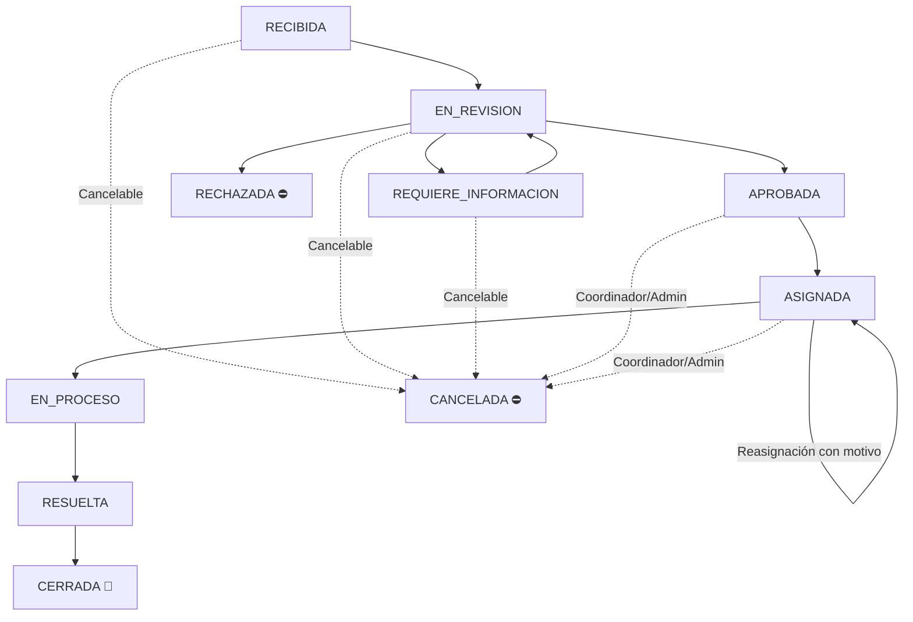

# Referencia de la API REST — ServiGest Ecuador (P0)

Documentación técnica integral de la API REST de ServiGest. Describe los protocolos de autenticación, autorización por roles, ciclo de vida de solicitudes, intervenciones técnicas, asignación, catálogos, dashboard y canales en tiempo real vía Server-Sent Events (SSE).

---

## 1. Convenciones y Arquitectura

### 1.1. Principios REST Estrictos
- **Recursos en sustantivos y verbos HTTP:** Sin verbos ni acciones en la URL (`GET`, `POST`, `PUT`, `PATCH`, `DELETE`).
- **Transiciones de estado:** Centralizadas en `PATCH /api/solicitudes/:id/estado` enviando el estado destino y metadatos en el cuerpo.
- **Acciones administrativas:** Modeladas como subrecursos (por ejemplo, `POST /api/solicitudes/:id/token`).
- **Reemplazos de colecciones:** `PUT` reservado para reemplazar completamente colecciones hijas (por ejemplo, `PUT /api/tecnicos/:id/especialidades`).
- **Nombres de atributos:** JSON en `camelCase`; identificadores únicos en formato UUIDv4; marcas de tiempo en formato ISO 8601 (UTC).

### 1.2. Autenticación y Seguridad
- **Sesión persistente:** Cookie `sg_session` (httpOnly, SameSite=Lax, Secure en producción). En la base de datos se almacena únicamente el hash SHA-256 del token de sesión. Expiración absoluta: 12 horas.
- **Protección CSRF:** Todo método mutante (`POST`, `PUT`, `PATCH`, `DELETE`) requiere el encabezado `X-CSRF-Token` con el token emitido al iniciar sesión o consultable en `GET /api/auth/me`.
- **Bloqueo y Rate Limiting:**
  - Login: máximo 10 intentos por cada 15 minutos por IP; 5 intentos fallidos consecutivos bloquean la cuenta durante 15 minutos.
  - Radicación pública: máximo 5 solicitudes por hora por IP.
- **Aislamiento por organización:** Las cuentas con rol `CLIENTE` están limitadas a su `organizacionId`. Las consultas a solicitudes o métricas de otras organizaciones devuelven siempre `404 Not Found` para evitar la enumeración de recursos (IDOR).

### 1.3. Formato Uniforme de Respuestas

#### Respuesta exitosa paginada
```json
{
  "data": [ ... ],
  "page": 1,
  "limit": 20,
  "total": 45
}
```

#### Respuesta de error
```json
{
  "error": {
    "code": "DATOS_INVALIDOS",
    "message": "Descripción clara del motivo del rechazo.",
    "details": {
      "campos": ["email"]
    }
  }
}
```

---

## 2. Matriz de Permisos por Rol

| Módulo / Recurso | Público | CLIENTE | TECNICO | COORDINADOR | ADMIN |
|---|:---:|:---:|:---:|:---:|:---:|
| Health (`/api/health`) | ✔ | ✔ | ✔ | ✔ | ✔ |
| Formulario y Categorías públicas | ✔ | ✔ | ✔ | ✔ | ✔ |
| Seguimiento público por token | ✔ | ✔ | ✔ | ✔ | ✔ |
| Login / Logout / Me / Password | — | ✔ | ✔ | ✔ | ✔ |
| Crear solicitud (`POST /solicitudes`) | — | ✔ (Org) | — | ✔ | ✔ |
| Listar solicitudes (`GET /solicitudes`) | — | ✔ (Solo Org) | ✔ (Solo Asignadas) | ✔ (Global) | ✔ (Global) |
| Detalle de solicitud | — | ✔ (Solo Org) | ✔ (Solo Asignada) | ✔ (Global) | ✔ (Global) |
| Transicionar estado (`PATCH /solicitudes/:id/estado`) | — | Solo cancelar antes de aprobar | — | ✔ | ✔ |
| Auditoría / Eventos (`/solicitudes/:id/eventos`) | — | — | — | ✔ | ✔ |
| Notas internas (`/solicitudes/:id/notas`) | — | — | ✔ (Asignado) | ✔ | ✔ |
| Regenerar token público | — | — | — | — | ✔ |
| Iniciar intervención (`POST /solicitudes/:id/intervenciones`) | — | — | ✔ (Asignado) | — | — |
| Resolver intervención (`PATCH /intervenciones/:id`) | — | — | ✔ (Asignado) | — | — |
| Listar intervenciones de solicitud | — | ✔ (Solo Org) | ✔ (Asignado) | ✔ | ✔ |
| Adjuntos de solicitud / intervención | — | ✔ (Solo Org) | ✔ (Asignado) | ✔ | ✔ |
| Descargar adjunto autenticado | — | ✔ (Solo Org) | ✔ (Asignado) | ✔ | ✔ |
| Listar/Consultar técnicos | — | — | — | ✔ | ✔ |
| Gestionar técnicos / Especialidades / Disponibilidad | — | — | — | — | ✔ |
| Organizaciones (CRUD) | — | — | — | — | ✔ |
| Usuarios (CRUD) | — | — | — | — | ✔ |
| Catálogos (CRUD) | — | — | — | — | ✔ |
| Dashboard operativo | — | ✔ (Métricas Org) | — | ✔ (Global + Carga) | ✔ (Global + Carga) |
| SSE Coordinación | — | — | — | ✔ | ✔ |
| SSE Técnico | — | — | ✔ | — | — |

---

## 3. Ciclo de Vida de las Solicitudes



### Reglas de Negocio en Transiciones (`PATCH /api/solicitudes/:id/estado`)

1. **`EN_REVISION`**: Solicitud tomada para evaluación técnica/operativa.
2. **`REQUIERE_INFORMACION`**: Requiere `nota` obligatoria explicando la información solicitada al requirente.
3. **`APROBADA`**:
   - Requiere `prioridad` (`BAJA`, `MEDIA`, `ALTA`, `CRITICA`).
   - Si la solicitud es de origen `PUBLICO`, requiere `constanciaAceptacion`.
   - Se congela la prioridad y se calcula automáticamente la `fecha_objetivo` del SLA en horas calendario (Crítica: 4 h, Alta: 8 h, Media: 24 h, Baja: 72 h).
4. **`ASIGNADA`**:
   - Requiere `tecnicoId` y `fechaProgramada` (ISO 8601).
   - Validaciones estrictas:
     - Técnico activo y con la especialidad requerida por la categoría.
     - Fecha programada futura y dentro de una franja de disponibilidad recurrente del técnico.
     - Sin colisión horaria: margen de al menos ±1 hora respecto a otra solicitud asignada o en proceso del mismo técnico.
     - Cumplimiento de SLA: `fechaProgramada <= fechaObjetivo`.
   - Si ya estaba en `ASIGNADA` (reasignación), el campo `motivo` es obligatorio y queda auditado.
5. **`EN_PROCESO`**: Se ejecuta a través de `POST /api/solicitudes/:id/intervenciones` cuando el técnico asignado inicia el servicio en campo.
6. **`RESUELTA`**: Se ejecuta a través de `PATCH /api/intervenciones/:id` al registrar la resolución técnica documentada.
7. **`CERRADA`**: Solo Coordinador o Admin pueden cerrarla una vez que la solicitud se encuentra `RESUELTA`.
8. **`CANCELADA`**: Válido desde cualquier estado no terminal con `motivo` documentado. El rol `CLIENTE` solo puede cancelar antes de que la solicitud pase a `APROBADA`.

---

## 4. Catálogo Detallado de Endpoints

### 4.1. Módulo Público

#### `GET /api/public/categorias`
Devuelve las categorías de soporte técnico activas para alimentar formularios públicos.
- **Respuesta 200:** Array de objetos `{ id, codigo, nombre, descripcion, nivelUrgenciaSugerido }`.

#### `POST /api/public/solicitudes`
Crea una solicitud pública sin necesidad de registro previo.
- **Content-Type:** `multipart/form-data`
- **Rate Limit:** 5 peticiones / hora por IP.
- **Campos del formulario:**
  - `solicitanteNombre` *(string, obligatorio)*
  - `solicitanteEmail` *(string, email válido, obligatorio)*
  - `solicitanteTelefono` *(string, opcional)*
  - `categoriaId` *(UUIDv4, obligatorio)*
  - `descripcion` *(string, obligatorio)*
  - `urgenciaVisitante` *(enum: BAJA, MEDIA, ALTA, obligatorio)*
  - `adjuntos` *(archivos binarios, hasta 5 archivos, máx. 5 MB c/u; formatos: jpg, png, pdf)*
- **Respuesta 201:**
  ```json
  {
    "id": "e30cf2c6-302a-43cf-87be-eeffaa112233",
    "codigo": "SOL-2026-00015",
    "tokenPublico": "kZ8_aX99Lq...",
    "estado": "RECIBIDA"
  }
  ```

#### `GET /api/public/seguimiento/:token`
Consulta el avance de una solicitud utilizando su token público único.
- **Parámetros URL:** `token` (string base64url de 32 bytes).
- **Respuesta 200:** Objeto con código, estado actual, categoría, descripción pública, fechas y lista de eventos públicos auditados.
- **Respuesta 404:** Token inexistente.

#### `GET /api/public/seguimiento/:token/eventos`
Canal SSE para suscripción a cambios de estado en vivo para la pantalla de seguimiento público.

---

### 4.2. Módulo de Autenticación

#### `POST /api/auth/login`
- **Body:** `{ "email": "admin@servigest.com.ec", "password": "..." }`
- **Respuesta 200:** Devuelve datos de usuario, `csrfToken` y fija la cookie `sg_session`.
- **Errores:** `400 CAMPOS_FALTANTES`, `401 CREDENCIALES_INVALIDAS`, `423 CUENTA_BLOQUEADA`, `429 LIMITE_LOGIN`.

#### `POST /api/auth/logout`
- **Headers:** `X-CSRF-Token: <token>`
- **Respuesta 204:** Sesión revocada en PostgreSQL y cookie limpiada.

#### `GET /api/auth/me`
- **Respuesta 200:** Datos del usuario autenticado y su token CSRF activo.

#### `PATCH /api/auth/password`
- **Headers:** `X-CSRF-Token: <token>`
- **Body:** `{ "actual": "...", "nueva": "..." }` (mínimo 8 caracteres).
- **Respuesta 204:** Contraseña actualizada.

---

### 4.3. Módulo de Solicitudes

#### `GET /api/solicitudes`
- **Query params:** `estado`, `prioridad`, `origen`, `q`, `page` (def. 1), `limit` (def. 20, máx. 100), `orden`.
- **Respuesta 200:** `{ data: [...], page, limit, total }`

#### `POST /api/solicitudes`
Crea una solicitud desde el portal autenticado (origen `CLIENTE` si la crea un cliente, o `PUBLICO` si la registra coordinación a nombre de un tercero).
- **Body:** `{ "categoriaId": "...", "descripcion": "...", "organizacionId"?: "...", ... }`
- **Respuesta 201:** `{ id, codigo, tokenPublico, estado: "RECIBIDA" }`

#### `GET /api/solicitudes/:id`
- **Respuesta 200:** Detalle completo de la solicitud. Si el usuario pertenece a otra organización, responde `404 Not Found`.

#### `PATCH /api/solicitudes/:id/estado`
- **Headers:** `X-CSRF-Token: <token>`
- **Body:**
  ```json
  {
    "estado": "ASIGNADA",
    "tecnicoId": "9d4f0148-5ba9-4f7f-bdc7-8c3ce449a001",
    "fechaProgramada": "2026-11-20T10:00:00.000Z",
    "motivo": "Reasignación por indisponibilidad"
  }
  ```

#### `GET /api/solicitudes/:id/eventos`
- **Roles:** `ADMIN`, `COORDINADOR`.
- **Respuesta 200:** `{ data: [{ id, tipo, actorNombre, estadoAnterior, estadoNuevo, metadata, fecha }] }`

#### `GET /api/solicitudes/:id/notas` & `POST /api/solicitudes/:id/notas`
- **Roles:** `ADMIN`, `COORDINADOR`, `TECNICO` (solo si está asignado a la solicitud).
- **Body POST:** `{ "contenido": "Detalle técnico interno..." }`

#### `POST /api/solicitudes/:id/token`
- **Roles:** `ADMIN`. Regenera el token de consulta pública ante extravío o brecha de seguridad.

---

### 4.4. Módulo de Intervenciones

#### `POST /api/solicitudes/:id/intervenciones`
Inicia los trabajos técnicos de la solicitud asignada.
- **Roles:** Exclusivo de `TECNICO` asignado a la solicitud.
- **Condición:** La solicitud debe encontrarse en estado `ASIGNADA`.
- **Efecto:** La solicitud pasa a `EN_PROCESO` y se crea una intervención abierta con timestamp de inicio.
- **Respuesta 201:** `{ intervencionId, solicitudId, inicio, estado: "EN_PROCESO", tecnicoId, codigo }`

#### `GET /api/solicitudes/:id/intervenciones`
- **Roles:** `ADMIN`, `COORDINADOR`, `TECNICO` (asignado), `CLIENTE` (solo solicitudes de su organización).
- **Respuesta 200:** `{ data: [ { id, inicio, fin, diagnostico, actividades, resultado, observaciones, tecnicoNombre } ] }`

#### `PATCH /api/intervenciones/:id`
Resuelve la intervención en curso y transiciona la solicitud a `RESUELTA`.
- **Roles:** Exclusivo de `TECNICO` asignado.
- **Headers:** `X-CSRF-Token: <token>`
- **Body:**
  ```json
  {
    "fin": "2026-11-20T12:30:00.000Z",
    "diagnostico": "Falla en fuente redundante del servidor de base de datos.",
    "actividades": "Reemplazo de módulo de alimentación y pruebas de carga continua.",
    "resultado": "Servidor operando en parámetros óptimos con doble redundancia.",
    "observaciones": "Se sugiere programar mantenimiento preventivo en 6 meses."
  }
  ```
- **Validaciones:** `fin > inicio`, longitudes mínimas de 10 caracteres en diagnóstico, actividades y resultado.

---

### 4.5. Módulo de Técnicos

#### `GET /api/tecnicos`
- **Roles:** `ADMIN`, `COORDINADOR`.
- **Query params:** `especialidadId`, `q`, `page`, `limit`, `orden`.

#### `POST /api/tecnicos`
Habilita a un usuario con rol `TECNICO` para recibir asignaciones.
- **Roles:** `ADMIN`.
- **Body:** `{ "usuarioId": "uuid", "notas": "..." }`

#### `GET /api/tecnicos/:id`
- **Roles:** `ADMIN`, `COORDINADOR`. Incluye especialidades asignadas y franjas horarias configuradas.

#### `PATCH /api/tecnicos/:id` & `DELETE /api/tecnicos/:id`
- **Roles:** `ADMIN`. Actualización de notas o desactivación del técnico.

#### `PUT /api/tecnicos/:id/especialidades`
Reemplaza el catálogo de especialidades asociadas al técnico.
- **Roles:** `ADMIN`.
- **Body:** `{ "especialidadIds": ["uuid-1", "uuid-2"] }`

#### `GET/POST /api/tecnicos/:id/disponibilidad`
- **Roles:** GET (`ADMIN`, `COORDINADOR`); POST (`ADMIN`).
- **Body POST:**
  ```json
  {
    "diaSemana": 1,
    "horaInicio": "08:00",
    "horaFin": "12:00"
  }
  ```
  *(1 = Lunes, 7 = Domingo)*

#### `PATCH/DELETE /api/tecnicos/disponibilidad/:franjaId`
- **Roles:** `ADMIN`. Edición o eliminación de franjas horarias.

---

### 4.6. Módulo de Catálogos (Especialidades y Categorías)

- **Roles requeridos:** `ADMIN` para todas las operaciones administrativas.
- `GET /api/catalogos/especialidades` — Listado con búsqueda (`q`) y paginación.
- `POST /api/catalogos/especialidades` — `{ "nombre": "Redes y Conectividad" }`
- `PATCH /api/catalogos/especialidades/:id` — Actualizar nombre.
- `DELETE /api/catalogos/especialidades/:id` — Desactivación lógica.
- `GET /api/catalogos/categorias` — Listado de categorías.
- `POST /api/catalogos/categorias` — `{ "codigo": "NET-01", "nombre": "Switches", "especialidadId": "uuid" }`
- `PATCH /api/catalogos/categorias/:id` — Actualización de categoría.
- `DELETE /api/catalogos/categorias/:id` — Desactivación de categoría.

---

### 4.7. Módulo de Organizaciones y Usuarios

- **Roles requeridos:** `ADMIN`.
- `GET/POST/PATCH/DELETE /api/organizaciones` — Gestión de empresas cliente (nombre, RUC de 13 dígitos, teléfono, dirección).
- `GET/POST/PATCH/DELETE /api/usuarios` — Gestión de usuarios internos y clientes.
- `PATCH /api/usuarios/:id/password` — Reinicio administrativo de contraseña.

---

### 4.8. Módulo de Dashboard

#### `GET /api/dashboard`
- **Roles:** `ADMIN`, `COORDINADOR`, `CLIENTE`.
- **Comportamiento según rol:**
  - `ADMIN` y `COORDINADOR`: Datos globales del sistema y desglose de `cargaTecnicos`.
  - `CLIENTE`: Datos filtrados exclusivamente por su `organizacionId`. El campo `cargaTecnicos` es `null`.
- **Estructura de respuesta:**
  ```json
  {
    "total": 34,
    "porEstado": {
      "RECIBIDA": 2,
      "EN_REVISION": 3,
      "APROBADA": 1,
      "ASIGNADA": 4,
      "EN_PROCESO": 2,
      "RESUELTA": 6,
      "CERRADA": 15,
      "CANCELADA": 1
    },
    "porPrioridad": {
      "BAJA": 5,
      "MEDIA": 12,
      "ALTA": 10,
      "CRITICA": 7
    },
    "sla": {
      "cumplidas": 19,
      "incumplidas": 2,
      "enRiesgo": 1
    },
    "mttrHoras": 6.4,
    "cargaTecnicos": [
      {
        "tecnicoId": "9d4f0148-5ba9-4f7f-bdc7-8c3ce449a001",
        "nombre": "Carlos Mendoza",
        "asignadas": 2,
        "enProceso": 1
      }
    ]
  }
  ```

---

### 4.9. Canales en Tiempo Real (Server-Sent Events)

Conexiones unidireccionales `text/event-stream` con heartbeat automático cada 25 segundos (`:heartbeat`).

1. **`GET /api/eventos/coordinacion`**
   - **Audiencia:** `ADMIN`, `COORDINADOR`.
   - **Eventos emitidos:**
     - `solicitud.creada`: Notificación de nueva solicitud entrante.
     - `solicitud.estado`: Actualización de estado en el flujo.
     - `solicitud.asignada` / `solicitud.reasignada`: Notificación de asignación de técnico.
     - `solicitud.cerrada`: Finalización y cierre operativo.
     - `intervencion.iniciada` / `intervencion.resuelta`: Avance técnico en campo.
2. **`GET /api/eventos/tecnico`**
   - **Audiencia:** `TECNICO`.
   - **Eventos emitidos:** Asignaciones y cambios de estado en sus órdenes asignadas.
3. **`GET /api/public/seguimiento/:token/eventos`**
   - **Audiencia:** Visitantes públicos.
   - **Payload sanitizado:** Nunca expone notas internas, resoluciones ni datos de contacto.

---

### 4.10. Módulo de Adjuntos Autenticados

Almacenamiento seguro fuera del web root (`uploads/`). Límite de 5 adjuntos por entidad, máx. 5 MB por archivo. Tipos permitidos: JPG, PNG, PDF (validados mediante *magic bytes*). No hay borrado de adjuntos en P0.

#### `POST /api/solicitudes/:id/adjuntos`
- **Roles:** `ADMIN`, `COORDINADOR`, `TECNICO` (asignado), `CLIENTE` (solicitud de su organización).
- **Content-Type:** `multipart/form-data` (`archivo`).

#### `POST /api/intervenciones/:id/adjuntos`
- **Roles:** Exclusivo de `TECNICO` asignado a la intervención.
- **Content-Type:** `multipart/form-data` (`archivo`).

#### `GET /api/adjuntos/:id/descargar`
- **Roles:** `ADMIN`, `COORDINADOR`, `TECNICO` (asignado), `CLIENTE` (solo su organización).
- **Comportamiento:** Stream con cabeceras de descarga. Si el usuario pertenece a otra organización, responde `404 Not Found`.

---

## 5. Códigos de Error Frecuentes

| Código HTTP | Error Code | Descripción |
|---|---|---|
| `400` | `CAMPOS_FALTANTES` | Uno o más campos requeridos no fueron provistos en el cuerpo. |
| `400` | `DATOS_INVALIDOS` | Tipos de datos, formatos de email o IDs no cumplen validaciones. |
| `400` | `RUC_INVALIDO` | El RUC provisto no cuenta con 13 dígitos numéricos. |
| `401` | `CREDENCIALES_INVALIDAS` | Correo o contraseña incorrectos. |
| `401` | `NO_AUTENTICADO` | Petición sin cookie de sesión válida o expirada. |
| `403` | `ACCESO_DENEGADO` / `ROL_NO_AUTORIZADO` | El rol del usuario no tiene permisos sobre la acción solicitada. |
| `403` | `CSRF_INVALIDO` | Falta o token CSRF inválido en métodos mutantes. |
| `404` | `SOLICITUD_NO_ENCONTRADA` | Recurso inexistente o perteneciente a otra organización. |
| `409` | `TRANSICION_INVALIDA` | Salto de estado no permitido en la máquina de estados. |
| `409` | `CHOQUE_HORARIO` | El técnico seleccionado ya tiene un compromiso en la ventana de ±1 h. |
| `422` | `CONSTANCIA_REQUERIDA` | Se intentó aprobar una solicitud pública sin constancia de aceptación. |
| `422` | `FUERA_DE_FRANJA` | La fecha programada no coincide con los horarios de disponibilidad del técnico. |
| `422` | `ESPECIALIDAD_REQUERIDA` | El técnico no cuenta con la especialidad requerida por la categoría. |
| `423` | `CUENTA_BLOQUEADA` | Cuenta suspendida temporalmente por 15 minutos tras 5 intentos fallidos. |
| `429` | `LIMITE_SOLICITUDES` / `LIMITE_LOGIN` | Límite de tasa de peticiones alcanzado. |
